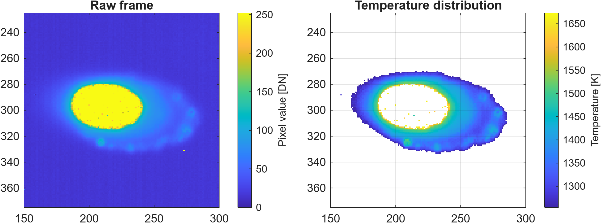
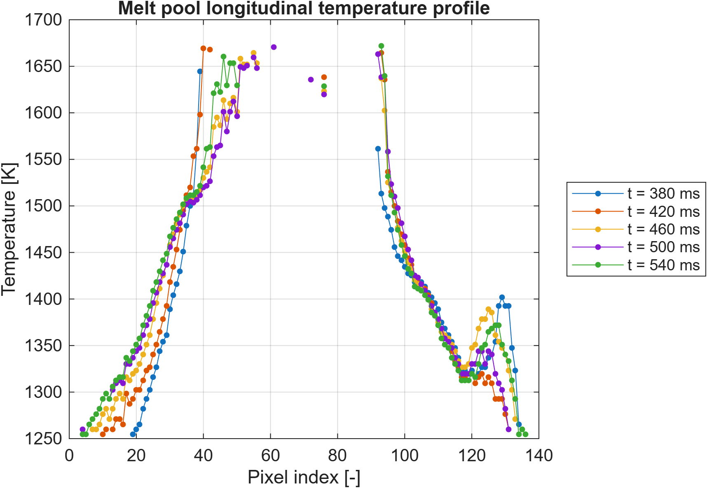
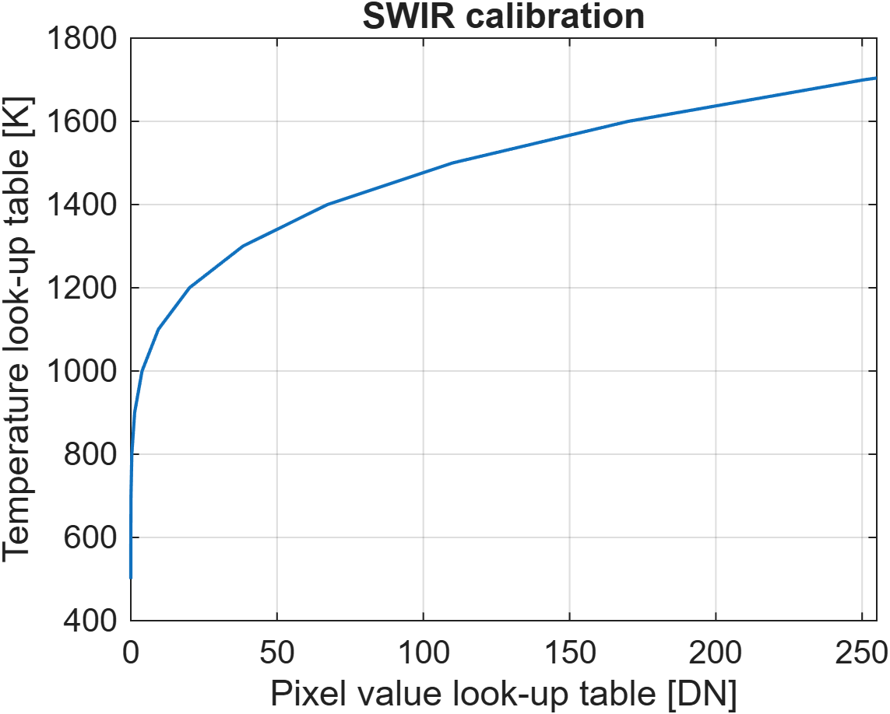

# swir-temp MATLAB package
Single-Band Temperature Estimation with a SWIR Camera

Author: Charles Snyers

## Overview

This repository contains a MATLAB implementation of single-band pyrometry using a monochrome SWIR camera to estimate temperature from raw image data.

The method relies on the grey-body assumption, considering the material emissivity to be approximately constant over the camera's spectral sensitivity band. Temperature estimation is based on the relationship between the measured pixel digital number (DN) and the theoretical blackbody radiation integrated over the camera's spectral response.

<div style="text-align: center;">

</div>
<div style="text-align: center;">

</div>

### Temperature estimation

Since a monochrome SWIR camera has a finite spectral sensitivity band, the theoretical signal is obtained by integrating the spectral radiance over the camera's spectral response:

$$
S_{\mathrm{th}}(T) =
\int_{\lambda_{\min}}^{\lambda_{\max}}
R(\lambda) B_\lambda(T)\,\mathrm{d}\lambda
$$

where $R(\lambda)$ is the dimensionless spectral response of the camera and $B$ is the blackbody radiance.

The theoretical signal is then scaled using a single experimental calibration point, consisting of a known temperature $T_{\mathrm{cal}}$ and its corresponding measured pixel signal $S_{\mathrm{cal}}$:

$$
S_{\mathrm{calib}}(T) =
S_{\mathrm{th}}(T)
\frac{S_{\mathrm{cal}}}
{S_{\mathrm{th}}(T_{\mathrm{cal}})}
$$

This scaling accounts for the unknown system conversion factor and the effective emissivity at the calibration point, assuming that both remain constant over the relevant spectral band.

Finally, the temperature of each pixel is obtained by inverting the calibrated signal-to-temperature relationship through interpolation:

$$
\hat{T}(x,y) =
S_{\mathrm{calib}}^{-1}
\left(S_{\mathrm{pixel}}(x,y)\right)
$$

In practice, this inversion is implemented using a temperature lookup table (LUT).


### Calibration

The calibration procedure consists of:

1. Obtaining the camera's spectral response $R(\lambda)$ over its sensitivity band from its datasheet.
2. Computing the theoretical blackbody signal $S_{\mathrm{th}}(T)$ over the desired temperature range by integrating Planck's law.
3. Acquiring a reference image at a known temperature $T_{\mathrm{cal}}$ and extracting the corresponding pixel value $S_{\mathrm{cal}}$.
4. Scaling the theoretical signal response such that it matches the experimental calibration point.
5. Generating the temperature and signal lookup tables used for pixel-wise temperature estimation.

<div style="text-align: center;">

</div>

The calibration relies on the assumption of approximately constant emissivity over the camera spectral band and a wavelength-independent system conversion factor. The calibration requires one reference measurement at a known temperature. This can be obtained using a thermocouple, a calibrated pyrometer or another suitable reference measurement. The calibrated temperature estimation is most reliable for temperatures close to the calibration temperature. Extrapolation to substantially different temperatures or application to different materials may introduce significant errors.

The resulting calibration is specific to:
- The material and its effective emissivity.
- The camera exposure time and acquisition settings.
- The optical configuration and camera spectral response.

## Usage

The code uses the following structure (see `main.m` for examples):

```matlab
[T_LU, S_LU] = swir_getCalib(wl_response, cam_response, ...
                             T_calibpoint, S_calibpoint, bitlength);

T = swir_fitTemp(deb_frames, T_LU, S_LU, S0, bitlength);
```

## License

This project is licensed under the [MIT License](LICENSE).